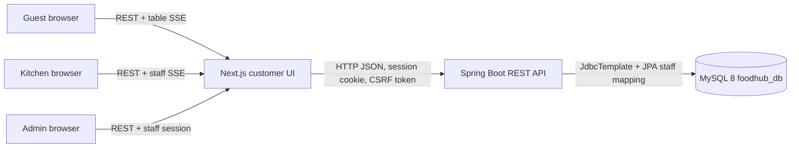
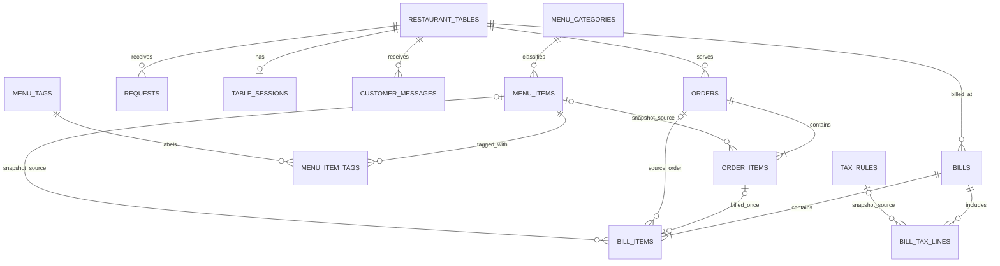

# FoodHub Restaurant Ordering System — DBMS Project Report Draft

> Draft for review and completion by the project team. The implementation and database scripts are present, but no MySQL instance was configured or exercised during this work. Mark demonstration evidence and final normalization claims only after verifying the local database.

## 1. Problem statement

Small restaurants often track menu availability, table orders, kitchen progress, bills, taxes, and customer requests in separate tools or paper notes. This makes it difficult to keep prices consistent, see current kitchen work, and preserve a reliable record of completed orders and payments.

FoodHub provides one relational system for guests, kitchen staff, and restaurant administrators. Guests order against a registered table. Spring Boot validates the order and reads current menu prices from MySQL. Kitchen staff update order status. Administrators manage the catalog, tables, taxes, staff access, and billing records.

## 2. Objectives and scope

- Keep restaurant data in MySQL 8 under `foodhub_db`.
- Use a Java 21 / Spring Boot REST backend and a Next.js / TypeScript frontend.
- Store order and bill line snapshots so later menu edits do not rewrite historical names or prices.
- Separate staff access into `ADMIN` and `KITCHEN` roles.
- Use constraints and transactions to protect relationships and billing operations.
- Demonstrate relational queries, an aggregate, a stored function, a stored procedure, and triggers.

The payment workflow records a staff-entered method and time. It does not process a card or contact a payment provider. The report does not claim a Firebase data export or migration was run.

## 3. Functional requirements

| ID | Requirement | Main data/API |
|---|---|---|
| FR-01 | Browse available menu items, categories, and dietary tags | `menu_items`, `menu_categories`, `menu_tags`; `GET /api/menu-items` |
| FR-02 | Place an order for an active table | `orders`, `order_items`; `POST /api/orders` |
| FR-03 | Recalculate order totals from stored menu prices | `menu_items.price`, transaction in `RestaurantService` |
| FR-04 | Accept, deny, and complete kitchen orders | `orders.status`; `PATCH /api/orders/{id}/status` |
| FR-05 | Send waiter/bill requests and customer messages | `requests`, `customer_messages` |
| FR-06 | Maintain restaurant tables and online-session activity | `restaurant_tables`, `table_sessions` |
| FR-07 | Generate a bill from completed, not-yet-billed lines | `bills`, `bill_items`, `bill_tax_lines` |
| FR-08 | Record Cash, Card, or UPI payment method and time | `bills.payment_method`, `paid_at` |
| FR-09 | Maintain menu, categories, tags, availability, and taxes | catalog and `tax_rules` APIs |
| FR-10 | Restrict staff actions by role and manage staff accounts | `staff_users`, Spring Security sessions |
| FR-11 | Show revenue and item aggregates from persisted records | `/api/analytics` |
| FR-12 | Notify kitchen and table views of committed updates | table-filtered server-sent events |

## 4. Non-functional requirements

- Credentials are provided through environment variables; the database password is not in source or frontend code.
- Staff passwords are hashed with Spring Security’s delegating encoder (BCrypt by default).
- SQL values are bound through `JdbcTemplate`; order totals and tax lines are calculated server-side.
- APIs validate request bodies and return JSON errors for common validation, conflict, and missing-row cases.
- The database upgrade path is additive. It does not drop tables or delete order/bill records.
- Customer, kitchen, and admin layouts have responsive CSS breakpoints and keyboard focus states.

## 5. Architecture



The application layer validates requests, coordinates transactional work, and publishes events only after a transaction commits. `JdbcTemplate` handles restaurant records; a small JPA entity maps `staff_users` so Hibernate `ddl-auto=validate` checks the authentication table at startup. `DatabaseSchemaVerifier` checks required columns across all application tables. Neither check is claimed as passed against a real server in this report draft.

## 6. ER and EER design



`staff_users.role` is the EER specialization discriminator: an enabled staff account is an administrator or kitchen user. The two roles share identity and password-hash attributes; route authorization differs by role. `menu_items` and `menu_tags` have a many-to-many relationship represented by `menu_item_tags`.

## 7. Relational schema and key relationships

| Relation | Primary key | Important relationships / indexes |
|---|---|---|
| `menu_categories` | `id` | unique `name`; referenced by `menu_items.category_id` |
| `menu_items` | `id` | category FK; availability and price checks; category index |
| `menu_tags` | `id` | unique `name` |
| `menu_item_tags` | (`menu_item_id`, `tag_id`) | FKs to items/tags; reverse tag index |
| `restaurant_tables` | `table_number` | positive table number; referenced by table activity and transactions |
| `orders` | `id` | FK to table; status and created-time indexes |
| `order_items` | auto-increment `id` | FK to order; optional menu FK; order snapshot columns |
| `requests` | `id` | FK to table; table index |
| `table_sessions` | `table_number` | one current activity record per registered table |
| `tax_rules` | `id` | active rate constrained to 0–100 percent |
| `bills` | `id` | FK to table; paid timestamp and payment method |
| `bill_items` | auto-increment `id` | FK to bill; unique nullable source order-item FK; snapshots |
| `bill_tax_lines` | auto-increment `id` | FK to bill; optional tax-rule FK; rate/amount snapshots |
| `customer_messages` | `id` | FK to table; table index |
| `restaurant_settings` | `setting_key` | one text value per setting name |
| `staff_users` | `username` | role, enabled flag, password hash; role/enabled index |

Order lines store item name, category, food type, unit price, quantity, and chef note at order time. Bill lines and tax lines store their own snapshots. Deleting or renaming a live catalog item therefore does not rewrite historic labels or amounts. The runtime API has no order-delete or bill-delete endpoint.

## 8. Functional dependencies and normalization

Representative functional dependencies (FDs):

- `menu_categories`: `id → name, sort_order`; unique `name → id, sort_order`.
- `menu_items`: `id → name, category_id, description, image_url, food_type, price, available`.
- `menu_tags`: `id → name`; unique `name → id`.
- `menu_item_tags`: `(menu_item_id, tag_id) → (no non-key attributes)`.
- `restaurant_tables`: `table_number → label, is_active, created_at`.
- `orders`: `id → table_number, total, status, chef_note, created_at, accepted_at, completed_at, denied_at`.
- `order_items`: `id → order_id, menu_item_id, name, category, food_type, unit_price, quantity, chef_note`.
- `requests`: `id → table_number, type, message, created_at`.
- `table_sessions`: `table_number → is_online, has_cart, bill_requested, last_seen, reset_at`.
- `tax_rules`: `id → name, percent, is_active, created_at`.
- `bills`: `id → table_number, subtotal, tax_total, grand_total, payment_method, created_at, paid_at, payment_updated_at`.
- `bill_items`: `id → bill_id, source_order_id, source_order_item_id, menu_item_id, snapshot attributes`; `source_order_item_id` is also unique when non-null.
- `bill_tax_lines`: `id → bill_id, tax_rule_id, name, percent, amount`.
- `customer_messages`: `id → table_number, type, message, created_at`.
- `restaurant_settings`: `setting_key → setting_value, updated_at`.
- `staff_users`: `username → password_hash, role, enabled, created_at`.

Most entities use a single-column key, so there are no partial dependencies on part of those keys. `menu_item_tags` has a composite key and no non-key attributes, so it satisfies 2NF and 3NF. The separate category and tag relations remove repeating category/tag facts from the relational core.

**Compatibility limitation:** `menu_items.category` and its JSON `tags` field remain as compatibility mirrors for the starter data and older clients. The current API maintains both the category link and tag junction rows. These duplicate values mean `menu_items` is not a strictly normalized 3NF representation while the mirrors remain. A later version can remove the mirrors through a separately reviewed migration after all clients use `category_id` and `menu_item_tags`. Order and bill line labels are intentional historical snapshots, not live catalog dependencies.

## 9. Anomalies and how the design addresses them

- **Update anomaly:** A category name stored only as text in many menu rows needs many edits. `menu_categories` provides one editable category name and `category_id` references it.
- **Insertion anomaly:** A tag could not be registered until it appeared on an item if tags lived only inside JSON. `menu_tags` allows independent tags; `menu_item_tags` attaches them as needed.
- **Deletion anomaly:** Removing an item from the menu must not erase the name/price from a completed order. `order_items` and `bill_items` preserve snapshots and optional catalog FKs are set null when catalog items are deleted.
- **Billing duplication:** A unique nullable `bill_items.source_order_item_id` and the bill-generation query exclude order items already linked to a bill. Legacy bill lines linked by `source_order_id` also exclude their whole source order from a new bill.
- **Orphan records:** Table/category/item/tax relationships are constrained by foreign keys after migration preflight checks show zero unresolved references.

## 10. Transactions, constraints, and database objects

Order creation validates active table, item availability, and quantity, reads each current price from MySQL, then writes the order and its item snapshots in one transaction. Bill generation locks candidate completed order lines, calculates subtotal and rounded tax lines, writes the bill and snapshots in one transaction, and marks the table bill request handled. Event notifications publish after commit.

`database/objects.sql` contains:

- `fn_tax_amount(base_amount, tax_percent)`: deterministic, currency-rounded tax amount.
- `sp_daily_revenue(from_day, through_day)`: daily paid-bill count and revenue aggregate for an inclusive date range.
- `bi_order_items_validate`: rejects invalid order quantities and negative unit prices.
- `ai_order_items_refresh_total`, `au_order_items_refresh_total`, `ad_order_items_refresh_total`: keep an order total aligned with its order lines after insert/update/delete.

The triggers are supplementary database rules. Application order creation also validates quantity and calculates the total in Java. Apply the SQL object script in Workbench using a user with routine and trigger privileges.

Example queries:

```sql
-- Order history with table and item snapshots
SELECT o.id, o.table_number, o.status, o.total, oi.name, oi.quantity, oi.unit_price
FROM orders o
JOIN order_items oi ON oi.order_id = o.id
ORDER BY o.created_at DESC, oi.id;

-- Paid revenue by day
SELECT DATE(paid_at) AS revenue_day, COUNT(*) AS paid_bills, SUM(grand_total) AS revenue
FROM bills
WHERE paid_at >= CURRENT_DATE - INTERVAL 6 DAY AND paid_at IS NOT NULL
GROUP BY DATE(paid_at)
ORDER BY revenue_day;

-- Categories and available menu counts
SELECT c.name, COUNT(i.id) AS available_items
FROM menu_categories c
LEFT JOIN menu_items i ON i.category_id = c.id AND i.available = TRUE
GROUP BY c.id, c.name
ORDER BY c.sort_order, c.name;

-- Invoke the DBMS demonstration routine
CALL sp_daily_revenue(CURRENT_DATE - INTERVAL 6 DAY, CURRENT_DATE);
```

## 11. Test and verification record

| Check | Result | Evidence / remaining work |
|---|---|---|
| Java compile and unit tests | Passed | `mvn clean test`; two tax calculation tests, no failures |
| Frontend TypeScript | Passed | `npm.cmd run typecheck` |
| Frontend production build | Passed | `npm.cmd run build`; customer, kitchen, admin, and login routes generated |
| SQL scripts on MySQL 8 | Not run | Run with Workbench and check all migration preflight counts |
| Hibernate validation | Not run against MySQL | `ddl-auto=validate`; mapped `staff_users` entity plus full startup column verifier |
| Database connectivity | Not tested | Requires the local DB account and schema setup |
| REST/API and role authorization | Not tested end-to-end | Requires backend process and MySQL schema |
| SSE updates and subscriber isolation | Not tested in a browser | Server filters public subscriptions by table; staff stream requires a staff role |
| Customer → kitchen → bill flow | Not run end-to-end | Follow `docs/DEMO_GUIDE.md` after database setup |
| Responsive layout | CSS breakpoints implemented and code-reviewed | Verify at 390px, 768px, and desktop widths before final presentation |

## 12. Demonstration and evidence checklist

Capture screenshots only from the configured, running system. Suggested captures:

1. MySQL Workbench `SHOW TABLES` and a table definition with keys.
2. Customer ordering page with a real configured menu and active table.
3. Successful order and its persisted `orders` / `order_items` rows.
4. Kitchen board showing the same pending order, then accepted and completed status.
5. Bill with item and tax snapshots; payment method and timestamp after staff records payment.
6. Admin analytics populated by those real records.
7. Staff role test showing a kitchen account denied access to admin-only routes.
8. Responsive screenshots at a phone, tablet, and desktop viewport.

Do not use placeholder values as proof of database-backed features.

## 13. Individual contribution

Use `docs/CONTRIBUTION_TEMPLATE.md`. Each member should list their own implemented work and explain one part of the ER model, normalization, and SQL behavior during the viva.

## 14. Viva questions

See `docs/VIVA_QA.md` for short answers on normalization, keys, transactions, snapshots, referential actions, indexing, and security boundaries.
